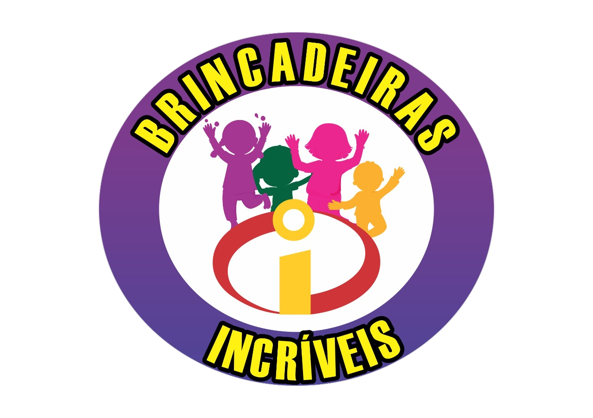

<div align="center">

  

  <h1>🎉 Brincadeiras Incríveis</h1>
  <h3>Landing Page Interativa de Recreação & Animação Infantil para Festas, Escolas e Eventos</h3>

  <p>
    <a href="https://brincadeirasincriveis.vercel.app" target="_blank">
      
    </a>
    <a href="https://wa.me/5562984568686" target="_blank">
      
    </a>
  </p>

  <p>
    
    
    
    
    
  </p>

</div>

<hr />

## ✨ Sobre o Projeto

**Brincadeiras Incríveis** é uma Landing Page de alta conversão desenvolvida como projeto de portfólio real para serviços de **recreação infantil, pintura facial, escultura com balões, gincanas aquáticas e oficinas criativas**.

O projeto foi construído com foco em **experiência do usuário (UX/UI)**, **performance máxima (Zero Dependências / Vanilla Web)**, acessibilidade (`ARIA`, `<dialog>` nativo, `prefers-reduced-motion`) e **captação inteligente de leads direto para o WhatsApp**.

<br />

<div align="center">
  <a href="https://brincadeirasincriveis.vercel.app" target="_blank">
    
  </a>
  <p><i>📸 Clique na imagem acima para abrir o site em produção: <a href="https://brincadeirasincriveis.vercel.app"><b>brincadeirasincriveis.vercel.app</b></a></i></p>
</div>

<hr />

## 🚀 Funcionalidades & Destaques Técnicos

<table>
  <tr>
    <td width="50%" valign="top">
      <h3>🎨 Design & UI/UX Interativa</h3>
      <ul>
        <li><b>Design System em CSS Variables:</b> Paleta vibrante infantil (Laranja, Ciano, Magenta, Lima, Amarelo e Roxo) com <code>color-mix()</code> nativo.</li>
        <li><b>Abas Dinâmicas de Duração (2h / 3h):</b> Alternância instantânea de preços e quantidade de recreadores sem recarregar a página.</li>
        <li><b>Carrossel Touch & Drag:</b> Navegação fluida pelas 8 oficinas criativas com suporte a arraste no mouse/touch e <code>scroll-snap</code>.</li>
        <li><b>Animações com IntersectionObserver:</b> Efeito de entrada suave (<i>scroll reveal</i>) e respeito automático a <code>prefers-reduced-motion</code>.</li>
      </ul>
    </td>
    <td width="50%" valign="top">
      <h3>⚡ Engenharia & Conversão</h3>
      <ul>
        <li><b>Modal Inteligente de Orçamento (<code>&lt;dialog&gt;</code>):</b> Filtra automaticamente se o combo escolhido inclui oficina ou não (ex.: Combos Rosa e Amarelo ocultam a seleção de oficina).</li>
        <li><b>Gerador Dinâmico de Mensagem WhatsApp:</b> Monta o resumo completo do pedido (Combo + Duração + Oficina + Nº de Crianças) e redireciona para a API oficial do WhatsApp.</li>
        <li><b>Renderização Orientada a Dados:</b> Cards de combos, oficinas e FAQ gerados dinamicamente via JavaScript puro e modular.</li>
        <li><b>100% Responsivo (Mobile-First):</b> Layout adaptado para smartphones, tablets e desktops.</li>
      </ul>
    </td>
  </tr>
</table>

<hr />

## 🎈 Catálogo de Combos Implementados

<table>
  <thead>
    <tr>
      <th align="left">Combo</th>
      <th align="left">Foco Principal</th>
      <th align="left">Atividades Inclusas</th>
      <th align="center">2 Horas (1 / 2 Recr.)</th>
      <th align="center">3 Horas (1 / 2 Recr.)</th>
    </tr>
  </thead>
  <tbody>
    <tr>
      <td><b>🎨 Combo Rosa</b></td>
      <td>Pintura Facial & Balões</td>
      <td>Pintura antialérgica profissional + Esculturas com balões <i>(Adicional: Camarim Infantil +R$ 50)</i></td>
      <td align="center">R$ 450 / R$ 550</td>
      <td align="center">R$ 550 / R$ 650</td>
    </tr>
    <tr>
      <td><b>🎈 Combo Amarelo</b></td>
      <td>Brincadeiras & Balões</td>
      <td>Brincadeiras, gincanas, circuitos adaptados por idade e balões</td>
      <td align="center">R$ 500 / R$ 650</td>
      <td align="center">R$ 600 / R$ 750</td>
    </tr>
    <tr>
      <td><b>🏃 Combo Verde</b></td>
      <td>Recreação Solo + Oficina</td>
      <td>Brincadeiras, gincanas, músicas infantis, <b>1 oficina à escolha</b> e balões</td>
      <td align="center">R$ 550 / R$ 680</td>
      <td align="center">R$ 650 / R$ 780</td>
    </tr>
    <tr>
      <td><b>💦 Combo Azul</b></td>
      <td>Recreação Aquática</td>
      <td>Brincadeiras aquáticas, <b>1 oficina à escolha</b>, balões e torta na cara opcional</td>
      <td align="center">R$ 550 / R$ 680</td>
      <td align="center">R$ 650 / R$ 780</td>
    </tr>
    <tr>
      <td><b>🎉 Combo Roxo</b> <kbd>Mais Completo</kbd></td>
      <td>Recreação Completa</td>
      <td>Pinturinha facial, gincanas, músicas, <b>1 oficina à escolha</b>, auxílio no parabéns e balões</td>
      <td align="center">R$ 550 / R$ 680</td>
      <td align="center">R$ 650 / R$ 780</td>
    </tr>
  </tbody>
</table>

<hr />

## 🧪 Oficinas Criativas no Carrossel

<div align="center">
  <table>
    <tr>
      <td align="center" width="25%">🧪<br /><b>Slime</b><br /><small>Massinha geleca colorida e com brilho</small></td>
      <td align="center" width="25%">🏺<br /><b>Vasinho de Argila</b><br /><small>Esculturas feitas à mão</small></td>
      <td align="center" width="25%">📿<br /><b>Pulseiras & Tornozeleiras</b><br /><small>Miçangas coloridas para criar acessórios</small></td>
      <td align="center" width="25%">🎨<br /><b>Massinha Comestível</b><br /><small>Play Dooh seguro para os pequenos</small></td>
    </tr>
    <tr>
      <td align="center" width="25%">🧁<br /><b>Oficina de Cupcake</b><br /><small>Decoração deliciosa com confeitos</small></td>
      <td align="center" width="25%">🔑<br /><b>Chaveiro com Nome</b><br /><small>Chaveiros personalizados de letrinhas</small></td>
      <td align="center" width="25%">✏️<br /><b>Lápis Decorado</b><br /><small>Material escolar cheio de personalidade</small></td>
      <td align="center" width="25%">🫧<br /><b>Bolha de Sabão Gigante</b><br /><small>Bolhas enormes que encantam a festa</small></td>
    </tr>
  </table>
</div>

<hr />

## 📂 Estrutura de Arquivos

```text
📦 brincadeiras-incriveis
 ┣ 📂 assets/
 ┃ ┣ 🖼️ hero.jpg          # Imagem alternativa de estação de pintura facial
 ┃ ┗ 🖼️ logo.png          # Logotipo oficial Brincadeiras Incríveis
 ┣ 📂 imagens/
 ┃ ┗ 🖼️ WhatsApp Image... # Foto principal da recreação infantil na piscina
 ┣ 📜 index.html          # Estrutura semântica HTML5, seções e modal <dialog>
 ┣ 📜 styles.css          # Design System, animações, grid responsivo e temas dos combos
 ┣ 📜 script.js           # Dados dos combos/oficinas, abas de preço, carrossel e integração WhatsApp
 ┗ 📜 README.md           # Documentação e apresentação de portfólio
```

<hr />

## 💻 Como Executar Localmente

O projeto não requer instalação de dependências pesadas:

```bash
# 1. Clone este repositório
git clone https://github.com/bruninhasungaila-tech/brincadeiras-incriveis.git

# 2. Acesse a pasta do projeto
cd brincadeiras-incriveis

# 3. Inicie um servidor HTTP simples (ex.: com Python ou Node)
python -m http.server 3000
```

Depois, basta abrir **`http://localhost:3000`** no seu navegador!

<hr />

<div align="center">
  <p>Desenvolvido com 💜 por <b><a href="https://github.com/bruninhasungaila-tech">Bruna Sungaila</a></b></p>
  <p>
    <a href="https://brincadeirasincriveis.vercel.app">🌐 Ver Projeto Online</a> •
    <a href="https://github.com/bruninhasungaila-tech">🐙 GitHub</a>
  </p>
</div>
